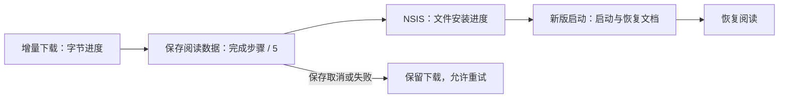

# 更新进度

目标：下载、保存阅读数据、替换程序、重新打开文档的每个阶段都有可见反馈，失败时保留用户数据并允许重试。

原先的断点在进程交接：Electron 退出后，静默 NSIS 安装器继续工作，应用内进度无法覆盖这段时间。现在沿用 electron-builder 的安装器，只通过官方 include hooks 显示其原生文件进度；没有复制或另写安装引擎。

准备进度 = 已完成步骤数 / 总步骤数。步骤耗时不同，因此不把它标成“安装完成百分比”，也不按计时器推进。安装阶段使用 NSIS 的真实进度控件。前端资源加载时用不定进度条，恢复文档完成后关闭进度面板。

旧客户端可能仍传 `/S`，新安装器在 `.onInit` 中对 `--updated` 调用 `SetSilent normal`。更新保留原安装范围，沿用既有提权处理；仅 `--updated --force-run` 跳过完成确认并自动启动。手动全新安装仍保留正常安装向导和完成页。

验证入口：

- `npm test`：完成前不启动安装；取消、保存错误和启动错误保留重试状态；重启完成清除进度。
- `scripts/installer-progress-test.ps1`：生产 NSIS hooks 的隔离程序，检测原生窗口可见、进度控件存在、旧静默参数被覆盖、安装范围保持、自动关闭与启动回调。只写临时目录，不安装或卸载真实软件。
- `scripts/installer-library-test.ps1`：原安装清理逻辑继续保留文库、笔记与用户文件。
- `scripts/update-progress-ui.mjs`：打包应用的明暗主题、步骤状态；执行真实保存和后台关闭流程，拦截最后的安装器启动；再启动应用，验证恢复 PDF 和一次性恢复标记的清理。

边界：隔离测试不改写 Windows 注册表，也不实际执行全机器提权安装。全机器安装的权限提示仍由 Windows 和上游安装器处理。

依据：[electron-builder NSIS 自定义 hooks](https://www.electron.build/nsis/)、[NSIS SetSilent](https://nsis.sourceforge.io/Reference/SetSilent)、[NSIS 安装页面](https://nsis.sourceforge.io/Docs/Chapter4.html)。参数行为以项目锁定的 electron-updater 6.8.9 和 app-builder-lib 安装模板为准。
